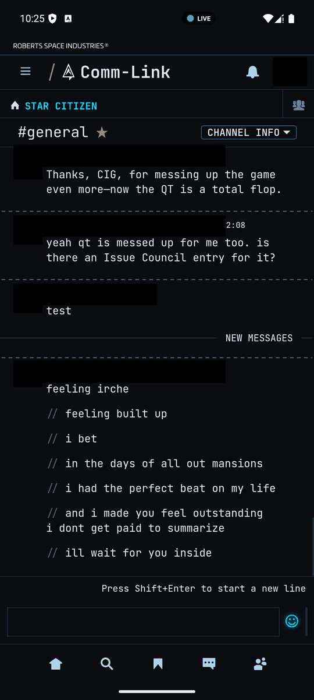
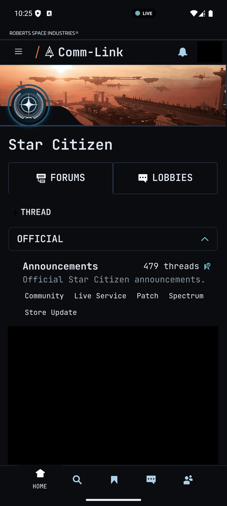
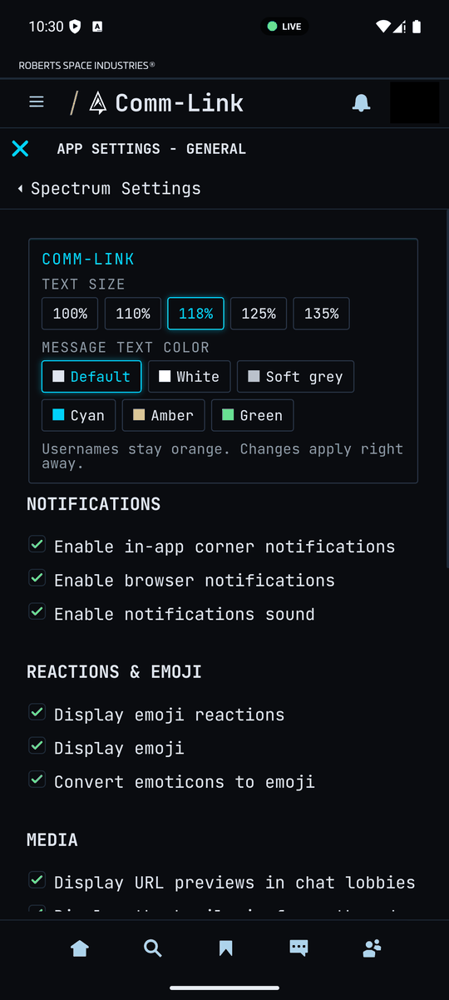
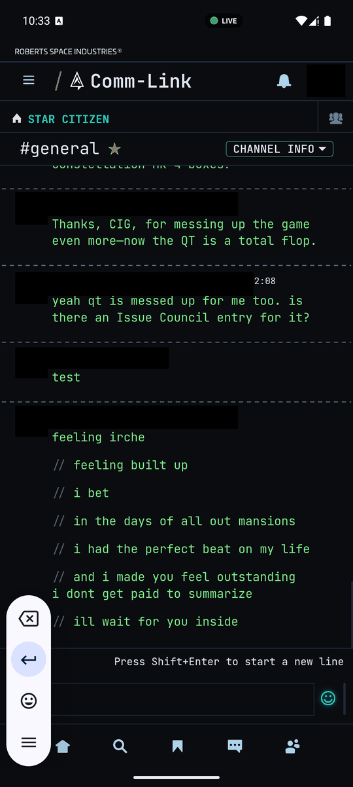
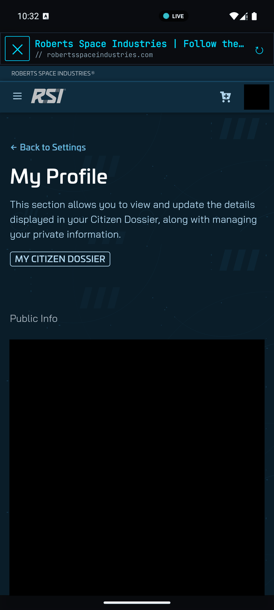

# Comm-Link

Comm-Link is a dark-themed app for RSI's Spectrum community chat, for Android and Windows. It is simply RSI's own Spectrum website (robertsspaceindustries.com/spectrum) shown in an app window with a cleaner theme. Comm-Link collects no data: there are no analytics or trackers, and your login goes straight to RSI. It never passes through Comm-Link or any other server.

## Always live, never stale

On Android, the mobile Spectrum site in a Chrome tab often goes stale: leave it for a while and it stops getting new messages without telling you. Comm-Link fixes that. It watches Spectrum's live connection the whole time, and if the connection drops, freezes, or the app comes back from the background or a network change, it reconnects and reloads straight back into Spectrum on its own. A small LIVE indicator shows when you're connected. The Windows app does the same, so chats and forums always show current data.

<em>A real chat lobby in Comm-Link. The LIVE pill sits at the top center of the status bar.</em>

- 🟢 **LIVE**: connected and receiving live data.
- 🟡 **CONNECTING**: opening the live connection for the first time.
- 🟡 **RECONNECT**: the connection dropped or went quiet, so Comm-Link is reconnecting and reloading on its own.
- 🔴 **OFFLINE**: no network. Comm-Link reloads as soon as you're back online.

Tap the pill to see when data last arrived.

## Screenshots

| Forums & Lobbies | Text size & color settings | Green message text | In-app browser |
|:---:|:---:|:---:|:---:|
|  |  |  |  |
| Community home with Forums and Lobbies | Pick a text size and message color | Green text, usernames stay orange | RSI links open in a built-in browser |

Usernames and personal details are blacked out.

### Settings

Text size and message color are under **☰ > Spectrum Settings**, in the Comm-Link panel at the top. Changes apply right away.

> **Unofficial fan project, not affiliated with or endorsed by Cloud Imperium Games / Roberts Space Industries. Star Citizen and Spectrum are trademarks of CIG.**

## Download

Get the latest builds from the [Releases page](../../releases).

- **Android:** `Comm-Link-Android-vX.XX.apk`
- **Windows:** `Comm-Link-Windows-X.X.X.zip`

## Install

### Android
1. Download the APK from the Releases page on your phone.
2. Open it. If prompted, allow your browser or file manager to **install unknown apps** (Settings > Apps > Special app access > Install unknown apps).
3. Tap **Install**. Future versions install over the top, and you stay signed in.

### Windows
1. Download the zip from the Releases page.
2. Extract it anywhere, for example `C:\Users\<you>\AppData\Local\Programs\Comm-Link`.
3. Run `Comm-Link.exe`.
4. The app isn't code-signed, so Windows SmartScreen may warn you. Click **More info > Run anyway**.

## Verify your download

Each release includes `SHA256SUMS.txt`. Check that your file's hash matches:

- Windows (PowerShell): `Get-FileHash .\Comm-Link-Windows-1.3.10.zip -Algorithm SHA256`
- Linux/macOS: `sha256sum -c SHA256SUMS.txt`

Android APKs are always signed with the same key, with certificate SHA-256 `2086b23a21cb0663f3b3eda7a353a82a21ea8bb3cd96c920f51d9b3981024422`.

## Free, forever

Comm-Link is free and made for the community. It isn't sold, there are no ads, and it makes no profit. o7 from Captain Starfish.
